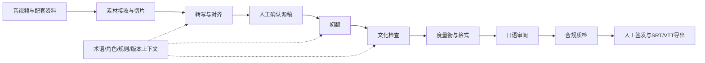

# 多语种字幕智能校对与文化适配系统

把音视频素材经过转写、初翻、文化检查、度量衡处理、口语审阅和合规检查，形成可由人工审核签发的字幕。这个仓库记录了从业务拆解、PRD、交互原型、Prompt/上下文设计，到本地工程实现和验证的过程。

**当前状态（2026-10-23）：已有本地前后端与六模块实现，完成部分工程回归与受控链路验证；尚未完成真实模型质量验收、全部正式业务用例或生产部署。**

## 老师先看这里

| 想了解什么 | 查看位置 | 重点观察 |
| --- | --- | --- |
| 做了什么、怎么做 | 本页下方框架与工作说明；[主PRD](docs/05-prd/mainprd.md)、[十份子PRD](docs/05-prd/README.md) | 需求、交互、权限、异常与验收如何拆分 |
| 最终结果与效果 | [六模块验证报告](docs/08-test-reports/20261023-e2e-report/20261023-e2e-full-pipeline-report.md) | 成功/失败对照、限制和报告§9的口径更正 |
| 页面长什么样 | [整页截图](docs/08-test-reports/20261023-e2e-report/screenshots/01-e2e-full-page.png)、[分面板截图](docs/08-test-reports/20261023-e2e-report/screenshots) | 截图由真实面板DOM注入测试回执渲染，非实时模型会话 |
| 最终导出文件 | [SRT/VTT示例](docs/08-test-reports/20261023-e2e-report/exports)、[逐环节JSON回执](docs/08-test-reports/20261023-e2e-report/receipts) | 导出正文、时间码、版本锁、失败拦截与签发证据 |
| Prompt在哪 | [转写Prompt](code/backend/modules/asr_alignment/prompts)、[翻译/清稿/检查Prompt](code/backend/modules/translation/prompts)、[文化Prompt](code/backend/modules/culture_check/prompts) | 系统约束、任务输入、结构化输出；文件存在不代表所有路径已真实调用模型 |
| 上下文怎么管 | [上下文与规则子PRD](docs/05-prd/09-subprd-context-rules.md)、[知识服务实现](code/backend/modules/translation/knowledge.py)、[Prompt契约](code/backend/modules/translation/prompt_contract.py) | 按任务/作品/市场/语言筛选、术语锁、上下句窗口、知识快照与版本血缘 |
| 怎么防止AI乱改 | [初翻实现](code/backend/modules/translation/handler.py)、[合规实现](code/backend/modules/compliance/handler.py)、[身份控制](code/backend/shared/controls/auth.py) | 人工确认、旧revision冲突、规则准入、候选与签发分离 |
| 测试与剩余问题 | [测试代码](tests)、[模块内测试](code/backend/modules)、[唯一进度](docs/00-process/00-02-progress/progress.md) | 自动化回归与正式业务TC分开；历史进度按日期阅读 |
| AI协作怎么管理 | [AGENTS](AGENTS.md)、[项目规则](rules)、[工程交接](docs/07-delivery-plans/antigravity-source-engineering-handoff.md)、[每日日志](docs/00-process/00-01-logs) | 需求/AI设计、工程派发、独立核验与阶段记录的分工 |

## 项目框架



- **界面**：[原生HTML/JS/CSS](code/web)，提供素材、逐句审阅、知识、各检查模块与签发面板；[V3原型](docs/02-prototype/pages/index.html)保留产品设计过程。
- **服务**：[FastAPI入口](code/backend/main.py)接收操作请求，[modules](code/backend/modules)分离六模块职责，[workflow](code/backend/workflow)组织收料与交付。
- **共享能力**：[SQLite持久化](code/backend/db)、[本地受控存储](code/backend/shared/storage)、[媒体工具](code/backend/shared/tools/media.py)、[配置](config/settings.py)；模型适配与工程校验各自承担职责。
- **上下文**：知识服务维护术语等资料及不可变版本快照；翻译链路组装当前源稿、相邻句、锁定术语和相关知识。历史运行保留所用上下文，避免资料更新后无法回查。具体筛选与校验以实现和测试为准，不把共享context目录本身当作已运行能力。

## 本项目具体推进的工作

1. **业务与产品设计**：拆解字幕生产七个业务阶段，建立BRD、主/子PRD、原型、字段、规则与指标定义，明确正常、异常和权限行为。
2. **AI任务设计**：为转写、初翻、文化检查等定义输入输出、Prompt、术语/角色上下文及人工处理边界；将工程确定性检查与模型判断分开。
3. **工程落地与协作**：需求与AI设计由用户和Codex共同梳理，工程经Antigravity实现并由Codex检查；代码、任务安排、修复和交接记录保留在仓库中，不把协作产出全部归为个人独立编码。
4. **验证与证据**：对切片时间轴、锁词、文化规则、单位换算、口语节奏、签发防篡改等保留正反用例、JSON回执、导出文件与截图。具体执行范围见报告。

## 结果应该怎样理解

2026-10-23报告记录六模块受控验证通过，并记录模块测试281项、tests目录79项通过。这些是工程行为证据：例如旧版本提交被拒绝、违规内容阻断、签发后SRT/VTT对账一致。

**本次链路证据未调用真实付费模型**（`model_used=false`、`token_used=0`）。文化/翻译使用受控夹具，规则仍有`CANDIDATE/UNVERIFIED`状态，签发使用受控模拟规则解析器；截图也明确标注回执注入。因此不能据此宣称真实转写准确率、翻译质量、文化适配效果或生产可用。174条正式TC与6项发布演练仍未执行；西语数词一致性等已知问题见报告。

## 本地查看与运行

GitHub可以直接阅读文档、截图和导出示例；HTML应用需要本地服务。已有Python环境下安装[固定依赖](requirements.txt)，并准备FFmpeg/FFprobe；配置参考[空配置模板](.env.example)和[settings](config/settings.py)。从仓库根目录运行：

```powershell
python -m uvicorn code.backend.main:app --host 127.0.0.1 --port 8765
# 浏览器访问 http://127.0.0.1:8765
python -m pytest -q tests code/backend/modules
```

真实模型调用还需要有效配置、素材外发与预算授权；缺少条件会阻断，不把克隆仓库解释为已授权外传或付费。仓库不包含本机运行库、密钥、真实音视频或外层meeting/work原始材料；部分历史文档中的本机追溯链接需原工作区才能访问。

## 文档导航与仓库范围

[十二步产物总目录](docs/README.md) · [基础定义](docs/03-foundation/README.md) · [实施计划](docs/07-delivery-plans/main-delivery-plan-source-release.md) · [指标定义](docs/03-foundation/metrics.md)

本仓库保持Private，用于项目评审和归档，未启用公开Pages或生产部署。老师访问需要已有仓库权限，本轮不更改可见性或邀请成员。早期文档中的“仅设计/未开发”是当时记录，当前工程状态请结合本页、最新进度和带日期的执行证据阅读。
